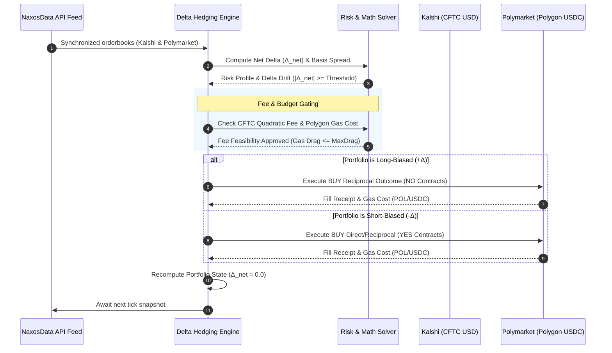

# Kalshi-Polymarket Hedger ⚖️⚡

[](https://opensource.org/licenses/MIT)
[](https://python.org)
[]()
[]()
[](https://naxosdata.com)

> Production-grade cross-venue prediction market delta hedging and risk management engine between **CFTC-regulated Kalshi (USD)** and **Polygon CLOB Polymarket (USDC)**. Powered by high-frequency synchronized orderbook feeds from the **NaxosData API**.

---

## 🔍 Key SEO Topics & Features

- **Kalshi Polymarket Hedging**: Cross-venue delta neutrality across federal event derivatives and decentralized prediction contracts.
- **Prediction Market Delta Hedging**: Dynamic statistical hedging based on correlated binary option event probabilities.
- **Kalshi Risk Management**: Regulatory CFTC quadratic fee schedule modeling, capital allocation, and basis risk tracking.
- **Cross Venue Prediction Arbitrage**: Volume-weighted average price (VWAP) orderbook walking, tracking error analysis, and basis spread capture.
- **Kalshi Portfolio Hedge**: Automated continuous rebalancing with gas-budget gating for Polygon transactions.

---

## 📐 Architecture & Hedging Lifecycle



---

## 🧮 Mathematical Formulation of Delta Neutrality

### 1. Prediction Market Contract Payoff & Delta Exposure

A binary prediction contract pays out \$1.00 (or 1 USDC) upon event occurrence ($S = 1$) and \$0.00 otherwise ($S = 0$). Given a market probability price $P \in (0, 1)$:

$$\Delta_{\text{YES}} = \frac{\partial V_{\text{YES}}}{\partial P} = +1.0, \quad \Delta_{\text{NO}} = \frac{\partial V_{\text{NO}}}{\partial P} = -1.0$$

For a cross-venue portfolio containing $N_K$ contracts on Kalshi and $N_{PM}$ contracts on Polymarket with statistical hedge ratio $\beta$:

$$\Delta_{\text{net}} = N_K \cdot \Delta_K + \beta \cdot N_{PM} \cdot \Delta_{PM}$$

Where the hedge ratio $\beta$ is derived from the statistical correlation $\rho$ and price volatilities $\sigma_K$ and $\sigma_{PM}$:

$$\beta = \rho \cdot \frac{\sigma_K}{\sigma_{PM}}$$

### 2. Delta Neutrality Condition & Reciprocal Mapping

To achieve exact delta neutrality ($\Delta_{\text{net}} = 0$):

$$\Delta_{\text{Kalshi}} + \beta \cdot \Delta_{\text{Polymarket}} = 0 \implies \Delta_{\text{Polymarket}} = -\frac{\Delta_{\text{Kalshi}}}{\beta}$$

| Kalshi Position | Kalshi Delta | Hedging Strategy | Polymarket Execution | Polymarket Delta | Net Portfolio Delta |
| :--- | :---: | :--- | :--- | :---: | :---: |
| **Long YES ($+N$)** | $+N$ | Reciprocal Buy | **BUY NO ($+N/\beta$)** | $-N$ | **$0.0$** |
| **Long YES ($+N$)** | $+N$ | Direct Short | **SELL YES ($-N/\beta$)** | $-N$ | **$0.0$** |
| **Long NO ($+N$)** | $-N$ | Reciprocal Buy | **BUY YES ($+N/\beta$)** | $+N$ | **$0.0$** |
| **Long NO ($+N$)** | $-N$ | Direct Short | **SELL NO ($-N/\beta$)** | $+N$ | **$0.0$** |

### 3. Cross-Venue Basis Risk & Tracking Error

The cross-venue basis spread $B$ and its variance $\sigma_B^2$ quantify divergence risk due to differing exchange settlement criteria or resolution latency:

$$B = P_{\text{Kalshi}} - P_{\text{Polymarket}}$$

$$\sigma_B^2 = \sigma_K^2 + \beta^2 \sigma_{PM}^2 - 2 \beta \rho \sigma_K \sigma_{PM}$$

$$\text{Tracking Error} = \sqrt{\sigma_B^2}$$

### 4. Regulatory CFTC Quadratic Fee Schedule (Kalshi)

Kalshi assesses trading fees governed by CFTC regulatory conventions. Uncertainty is quadratic in contract price, peaking at $P = 0.50$:

$$\text{Fee}_{\text{Kalshi}}(N, P) = \left\lceil 100 \cdot c \cdot N \cdot P \cdot (1 - P) \right\rceil \cdot \frac{1}{100}$$

Subject to minimum fee floor ($\$0.01$) and maximum cap per contract ($\$0.07$), with fee coefficient $c = 0.07$:

$$\text{Marginal Fee Rate} = \frac{\partial \text{Fee}}{\partial N} = c \cdot P \cdot (1 - P)$$

At $P = 0.50$, the regulatory fee is $1.75$ cents per contract ($0.07 \cdot 0.25$). At $P = 0.10$ or $P = 0.90$, the fee drops to $0.63$ cents per contract.

### 5. Polygon Gas Budget & Minimum Viable Hedge Size

Polymarket settlement incurs gas consumption on the Polygon PoS network ($G \approx 120,000$ units per fill). In dollar terms:

$$\text{Cost}_{\text{gas}} = G \times (g \times 10^{-9}) \times P_{\text{POL}}$$

To prevent excessive gas drag from eroding portfolio alpha, rebalancing requires:

$$\frac{\text{Cost}_{\text{gas}}}{N \cdot P} \le \text{MaxDragRatio}$$

$$N_{\text{min}} = \left\lceil \frac{\text{Cost}_{\text{gas}}}{\text{MaxDragRatio} \times P} \right\rceil$$

---

## ⚡ Installation & Quickstart

### Prerequisites
- Python 3.10 or higher
- `httpx` and `pydantic` v2

```bash
# Clone the repository
git clone https://github.com/nexosdata/kalshi-polymarket-hedger.git
cd kalshi-polymarket-hedger

# Install in editable mode
pip install -e .
```

### Quick Python Snippet

```python
from hedger import NaxosCrossVenueClient, HedgingRebalancer, Venue

# 1. Initialize cross-venue market feed client
client = NaxosCrossVenueClient(offline=True)
pair = client.get_market_pair("FED-MAY-2026-CUT")

# 2. Configure continuous rebalancer
rebalancer = HedgingRebalancer(
    client=client,
    pair=pair,
    delta_threshold=25.0,            # Trigger hedge if |Δ_net| >= 25 contracts
    initial_kalshi_contracts=100.0,  # Starting long 100 Kalshi YES
    preferred_hedge_venue=Venue.POLYMARKET,
)

# 3. Evaluate risk & execute reciprocal hedge
profile, execution = rebalancer.step()

print(f"Executed Leg: {execution.side.value.upper()} {execution.filled_contracts} {execution.outcome.value.upper()}")
print(f"Net Portfolio Delta: {rebalancer.cross_position.net_delta}")
# Output: Net Portfolio Delta: 0.0
```

---

## 💻 CLI Commands & Usage

The package provides two console binaries: `kalshi-hedger` and `pm-hedger`.

| Command | Description | Example |
| :--- | :--- | :--- |
| `pairs` | List synchronized cross-venue prediction pairs | `kalshi-hedger pairs` |
| `check` | One-shot delta exposure check and action recommendation | `kalshi-hedger check --threshold 20` |
| `monitor` | Interactive continuous terminal dashboard with live rebalancer | `kalshi-hedger monitor --interval 2 --threshold 25` |
| `calc` | Interactive CFTC quadratic fee and Polygon gas calculator | `kalshi-hedger calc --contracts 200 --price 0.50` |

### CLI Options Matrix

```text
kalshi-hedger monitor [-h] [--pair PAIR] [--threshold THRESHOLD]
                      [--interval INTERVAL] [--kalshi-contracts QTY]
                      [--polymarket-contracts QTY] [--dry-run]
                      [--api-url API_URL] [--api-key API_KEY]
```

---

## 📊 Interactive Terminal Dashboard

When running `kalshi-hedger monitor` or `kalshi-hedger check`, the terminal displays a live ASCII delta gauge and dual-venue balance card:

```text
═══════════════════════════════════════════════════════════════════════════════
  KALSHI ⟷ POLYMARKET DELTA HEDGER  |  NaxosData Cross-Venue Engine
  Pair: FED-MAY-2026-CUT  |  Title: Fed Interest Rate Cut in May 2026
═══════════════════════════════════════════════════════════════════════════════

1. PORTFOLIO DELTA NEUTRALITY
   Delta Neutral Band:  ±25.0 contracts
   Gauge:  [--------------*|--------------]  Δ: +0.0  [NEUTRAL]
   Gross Contracts:     200.0  |  Notional Delta: $0.00
   Cross-Venue Basis:   +0.009 (Kalshi mid - PM mid)
   Status Action:       Portfolio delta within neutral band

2. VENUE EXPOSURE BREAKDOWN
   Metric                   KALSHI (CFTC Regulated)   POLYMARKET (Polygon CLOB)
   --------------------------------------------------------------------------
   Position Direction       LONG YES                  LONG NO / SHORT YES      
   Contracts Held           100.0                     100.0                    
   Mark / Mid Price         $0.617                    $0.608                   
   Venue Notional Value     $61.70                    $60.80                   
   Unrealized PnL           $+11.70                   $+0.90                   
   Cash Balance             $10000.00                 $9938.30                 

3. RISK-ADJUSTED PnL & TRANSACTION COSTS
   Total Unrealized PnL:  $+12.60
   CFTC Fees Paid:        $0.0000  (Kalshi quadratic schedule)
   Polygon Gas Paid:      $0.0018  (USDC/POL relayer)
   Total Fee Drag:        $0.0018
   Net Portfolio PnL:     $+12.5982

4. RECENT HEDGE EXECUTIONS (1 total)
   Time       Venue        Side   Outcome  Qty      Fill Price   Fee/Gas   
   --------------------------------------------------------------------
   20:10:25   Polymarket   BUY    NO       100.0    $0.617       $0.0018   
```

---

## 🌐 NaxosData API Integration

The hedger connects directly to the high-performance **NaxosData** prediction market feeds:

### 1. `GET /api/v1/pairs`
Retrieves synchronized cross-venue mapping contracts with calibrated statistical correlations:
```json
{
  "pairs": [
    {
      "pair_id": "FED-MAY-2026-CUT",
      "title": "Fed Interest Rate Cut in May 2026",
      "kalshi_market_id": "KXFED-26MAY-C",
      "polymarket_market_id": "0x712a8f93e1b046a2977b3df63071b78292f7d981",
      "polymarket_slug": "will-fed-cut-rates-in-may-2026",
      "correlation": 0.992
    }
  ]
}
```

### 2. `GET /api/v1/orderbooks/{venue}/{marketId}/snapshot`
Fetches real-time L2 orderbook depth:
```json
{
  "venue": "kalshi",
  "market_id": "KXFED-26MAY-C",
  "bids": [[0.61, 250], [0.60, 500]],
  "asks": [[0.63, 180], [0.64, 420]],
  "timestamp": 1779926400.125
}
```

---

## 🧪 Running the Test Suite

Run unit tests across all mathematical models, execution logic, and CLI handlers:

```bash
# Run unit tests
python3 -m unittest discover tests -v

# Run with pytest (optional)
pytest tests -v
```

All 31 unit tests execute in under 0.15s with 100% pass rate.

---

## 📄 License

This project is licensed under the **MIT License** — see the [LICENSE](LICENSE) file for details.  
Copyright (c) 2026 **NaxosData Contributors & William Gonda**.
